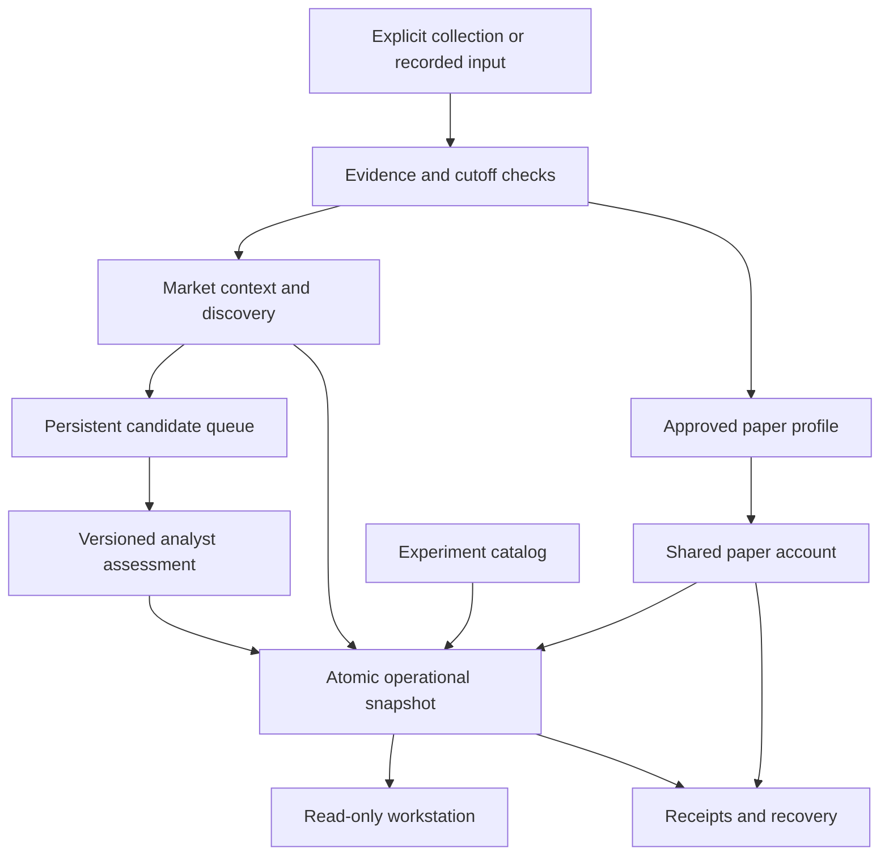

# KOD operating architecture

The operating unit is an explicit run with a cutoff, retained membership, immutable inputs, a versioned paper profile and a verifiable output. Research findings, observational candidates and simulated transactions have separate authority. A screen rank cannot authorize a transaction.

The [component guide](COMPONENTS.md) maps the optional validation, strategy,
research-worker and simulation-executor interfaces. These extend the operating
system without changing the pinned account or admitting new strategies.

| Section | Responsibility | Boundary |
|---|---|---|
| Today | Run status, known scope, blockers and candidate context | Supplied membership is not whole-market coverage |
| Candidates | Retained detections, evidence, versioned assessments and expiry | Detection and research do not authorize entry |
| Market map | Relative prices, turnover and peer participation | Descriptive; no validated predictive routes |
| Paper portfolio | One shared BTC/ETH USDT cash account, intents, later-quote simulated fills and persistent risk stops | A distinct simulation profile; no broker balances or live orders |
| Experiments | Source-backed protocols, negative results, pending corrections and future tests | Implemented code is not a successful prospective trial |
| Timing | Linked attempts, intraday coverage, source delays, prepared events and paper-intent execution clocks | Actual processing, historical references and independent time evidence remain distinct |
| Existing analyst workstation | Preserved company sources, dossiers, calculations, forecasts and replay | Its existing evidence and decision records remain authoritative for those workflows |

## What is connected

`idxsig.runtime` validates inputs, owns the paper-account journal, preserves the candidate queue, and publishes the snapshot read by `kod.workstation.operations`. `idxsig.experiment_catalog` supplies research status. The existing workstation research database and historical trial ledgers are retained separately; the new runtime does not infer current holdings or rewrite historical fills from them. A new runtime has a new cohort.

The existing primary-disclosure research tools remain available through the workstation. The new market-map collector covers explicitly requested Binance spot instruments. No claim of completed US equities, gold, ETF-flow, exchange-flow or all-crypto coverage follows from that collector. Those source adapters require their own membership and availability contracts before joining a run.

## Operating boundaries

- Run only through explicit commands or a separately configured schedule. This release installs no continuous monitor, alerts or local/cloud synchronization.
- Public capture, historical replay and synthetic demonstrations use isolated profiles and roots. Replay cannot accrue forward-trial days.
- Missing or stale prices produce unknown valuation, not zero. Fees and slippage are named simulation assumptions.
- Frozen studies and previous detectors remain unchanged. Corrections are additive and carry new evaluation identities.
- The selective-repricing mandate retains its own 1–5-session horizon and planned structural stop limit. The separate trend paper profile is not a replacement mandate.
- A local hash chain establishes byte consistency. It does not independently prove when information existed, profitability or a real broker fill.

See [RUNTIME.md](RUNTIME.md) for installation, commands, recovery and validation. See [TIMING_RESEARCH.md](TIMING_RESEARCH.md) for Hermes' timing evidence and the bounded next experiment.

## Timing integration, 4 November 2026

The timing sidecar is connected to explicit runtime processing, candidate
assessments, public capture, individual paper intents/fills and bounded intraday
observation. Existing account snapshots, economic IDs and frozen trials keep
their original schemas and bytes. Read `/timing` independently of the account
snapshot. Its projection is rebuilt from the append-only timing journal and
verified membership/raw/context/clock objects, and never grants entry permission.

`timing-demo` is an offline synthetic integration and recovery exercise.
`timing-capture` performs one explicitly requested bounded observation. The
existing daily workflow retains start/completion receipts alongside its original
ledger; no new continuous monitor or schedule is installed. See the
[build and command guide](../handoff/astra/TIMING_BUILD.md),
[full system map](../handoff/astra/SYSTEM_MAP.md), and
[frozen instrumentation protocol](../handoff/astra/protocols/TIMING_CAPTURE_v1/PROTOCOL.md).
